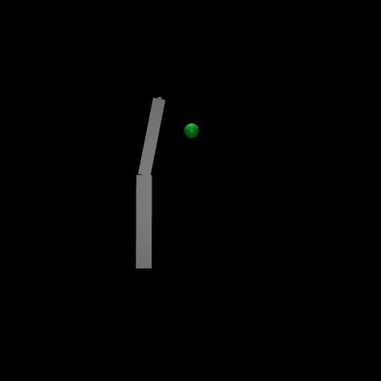

# mujoco-sim

Robotics simulation with [MuJoCo](https://github.com/deepmind/mujoco): load a robot described in a URDF file, add a scene (floor, light, camera, motors), simulate it and record a video.



*PPO agent moving the arm tip to random targets (green). Video: [docs/demo_policy.mp4](docs/demo_policy.mp4).*

## Project structure

```text
mujoco-sim/
├── robots/                 # URDF robot description files
│   └── arm.urdf            # two-joint test arm
├── src/mujoco_sim/
│   ├── scene.py            # build_model (URDF -> MuJoCo model), rollout (simulate + render)
│   └── envs/reach.py       # ArmReachEnv: Gymnasium reaching task
├── scripts/
│   ├── run_demo.py         # command line demo
│   └── train_ppo.py        # PPO training + baselines
├── notebooks/
│   └── kaggle_mujoco_rl.ipynb  # self-contained Kaggle notebook
├── test/
│   ├── test_scene.py       # unit tests
│   └── test_reach_env.py   # environment tests
├── pyproject.toml          # metadata and pytest configuration
└── requirements.txt
```

## Setup

```bash
python -m venv .venv
.venv\Scripts\Activate.ps1      # Windows PowerShell (Linux/macOS: source .venv/bin/activate)
pip install -r requirements.txt
pip install -e .
```

## Run

```bash
python scripts/run_demo.py --no-render    # physics only
python scripts/run_demo.py                # also renders output/demo.mp4
python -m pytest -v
```

## Reinforcement learning

```bash
pip install -r requirements-rl.txt
python scripts/train_ppo.py --steps 300000
python scripts/watch_policy.py            # live window
python scripts/make_video.py              # writes docs/demo_policy.mp4 and .gif
```

Task: bring the arm tip within 4 cm of a random target. Evaluation on 200 unseen targets (300k steps, CPU, ~3 min):

| policy | success | final distance |
|---|---|---|
| zero action | 0.00 | 0.443 m |
| random | 0.10 | 0.420 m |
| PPO | 1.00 | 0.031 m |

## Kaggle

Upload `notebooks/kaggle_mujoco_rl.ipynb`, set Internet to On, run all cells.

## Notes

- URDF describes links and joints only. The floor, light, camera and motors are added in `build_model`.
- Robot files with meshes: keep the mesh files next to the URDF and check that their paths are valid.
